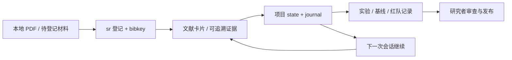

# sr · Scientific Research

**让科研上下文留在文件里，让下一次开工有明确起点。**

A local-first research workspace for papers, evidence, project checkpoints, and auditable agent workflows.

[](https://github.com/setsuna-1106/sr/actions/workflows/tests.yml)
[](https://www.python.org/)
[](LICENSE)

`sr` 是我在日常科研中逐步搭建的本地科研资产管理工具。它把文献、阅读证据、想法、项目断点和实验记录组织成可检查的 Markdown、BibTeX 与 JSON 文件，让人和 AI 在下一次会话继续工作。

核心机制：**规范管行为，资产管记忆，state 管断点。**

公开仓库提供代码、测试、空白工作区与虚构示例；真实科研资料由使用者在自己的工作区维护。当前版本是可用的早期工具，界面与提示主要为中文。

## 为什么做 sr

科研工作常分散在 PDF、笔记、聊天和脚本里。换一次会话，容易忘记结论依据、未确认的条件和下一步。`sr` 用文件保存这些信息，并检查文件之间是否一致：

- 一篇论文有固定 bibkey，PDF、精读卡和索引用同一个标识关联。
- 一个项目有 `state.md`，记录阶段、待确认项和下一步第一件事。
- AI 解释、原文证据与本人理解分别保存，避免把工具测试算成阅读进度。
- PDF 的大小与 SHA-256 可核验；登记失败时保留源文件并尝试回滚写入。

## 已实现

| 能力 | 入口 | 用途 |
|---|---|---|
| 项目概览 | `sr overview` | 从文件读取文献进度、收件箱和各项目下一步 |
| 文献登记 | `sr add-file` | 使用已核对元数据归档本地 PDF、登记书目与校验值 |
| 精读卡与索引 | `sr note / status / index` | 建卡、维护阅读状态、检查索引漂移 |
| 资产自检 | `sr doctor --verify --strict` | 检查书目、PDF、卡片、项目结构与哈希 |
| 项目与闪卡 | `sr new / card / tui` | 建立项目，捕获灵感、细节、问题和决定 |
| Zotero 接入 | `sr zotero` | 查询个人文库、按 DOI 对应、导入与打开 PDF |
| 伴读上下文 | `sr read` | 导出校验后的论文/页码/项目上下文，查找会话草稿 |
| PaperIR | `toolbox/paper-ir/paper_ir.py` | 为文本建立位置、哈希和精确引文记录 |
| 五角色执行流程 | `sr agents` | 保存证据、仿真、基线、红队与协调结果 |

`sr read` 提供本地上下文和记录入口；AI 对话需要另行配置 Zotero 插件与模型。`sr agents` 当前是确定性的本地执行器，不内置模型调用。

## 五分钟开始

需要 Python 3.10+。核心命令仅依赖 Python 标准库；当前支持 macOS/Linux，文件锁使用 `fcntl`。Zotero 自动打开命令使用 macOS 的 `open`；其他环境可先用 `--print-url` 获取链接。

```bash
git clone https://github.com/setsuna-1106/sr.git
cd sr
python3 scripts/sr.py help
python3 scripts/sr.py overview
python3 scripts/sr.py doctor --verify --strict
python3 scripts/check.py
```

初始文献库为空；`paper-ir` 与 `research-system` 是工具示例项目。测试使用临时目录，不需要真实文献、运行中的 Zotero 或模型账号。

创建自己的项目：

```bash
python3 scripts/sr.py new demo --desc '一个最小可复现的研究问题'
# 打开 projects/demo/state.md，填写日期与下一步第一件事
python3 scripts/sr.py card add demo --title '待验证问题' \
  --front '需要什么证据才能判断？' --kind 问题
python3 scripts/sr.py overview
```

希望使用短命令时，在仓库根目录运行：

```bash
export PATH="$PWD/bin:$PATH"
sr overview
```

准备保存真实研究内容时，先按[使用手册](docs/usage.md)建立独立工作副本。

## 试用可追溯证据

仓库内的传感器材料是**虚构演示**，可离线校验：

```bash
python3 toolbox/paper-ir/paper_ir.py validate \
  projects/paper-ir/examples/toy-paper.json
```

其中一条记录把“先测参考样本”的概括绑定到原文块 `b0003` 与精确子串，同时保存源文件哈希。通过校验说明来源与引文机械一致；概括是否准确仍需人读原文。

## 工作流



文本与代码可用 Git 管理，PDF 和大文件单独备份。`doctor` 的本机校验通过，不代表已经完成外部备份。

## 了解更多

- [使用手册](docs/usage.md)：文献登记、项目状态、闪卡和日常自检
- [架构与事实源](docs/architecture.md)：目录职责、数据流和 AI 协作边界
- [Zotero 与伴读](projects/research-system/ZOTERO_GUIDE.md)：可选集成及配置边界
- [PaperIR](projects/paper-ir/README.md)：带位置与哈希的原文证据
- [五角色执行流程](agents/README.md)：输入、依赖和运行资产
- [路线图](docs/roadmap.md)：组会助手等尚未实现的功能
- [公开范围](docs/public-scope.md)：模板、示例与个人科研资料的边界

## 验证与贡献

本版包含 48 项回归测试，覆盖登记失败回滚、重复 DOI、损坏 PDF、索引漂移、精确匹配、读取边界和 PaperIR 引文校验。GitHub Actions 在 macOS/Linux 上运行测试与空白工作区自检。

```bash
python3 scripts/check.py
python3 scripts/sr.py doctor --verify --strict
python3 scripts/sr.py index --check
git diff --check
```

欢迎通过 Issue 提交使用问题。修改时请保留来源、用户原话与研究判断的区别；不要在 Issue、测试或 PR 中加入私人文献、密钥和真实研究记录。见 [CONTRIBUTING.md](CONTRIBUTING.md)。

作者：[setsuna-1106](https://github.com/setsuna-1106) · [MIT License](LICENSE)
